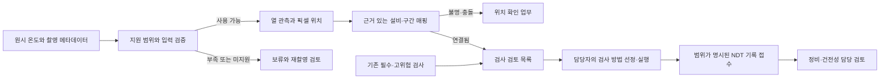

# MAEK 최종 목적에서 역산한 개발 계획

2026-11-08. 목표는 가스 배관의 균열·감육 관련 위험 구간을 정밀검사로 연결하여 사고 예방과 검사 자원 배분을 지원하는 것이다. 성과 판단 단위는 검출 마스크만이 아니라 **확인해야 할 구간을 빠뜨리지 않는 검사 경로**다. 실제 사고 감소·검사비 절감은 실측으로 검증해야 한다.

## 단계별 구현·검증 기준

| 단계 | 지금 구현하는 것 | 완료 판정 | 실측이 필요한 후속 검증 |
|---|---|---|---|
| 1. 입력 계약 | 온도 단위/배열, 촬영·기준 ID/시각, 센서·보정·운전 상태, 품질/정합 근거 확인 | 누락·오류를 정상으로 출력하지 않음 | 카메라별 온도 보정·잡음·환경 범위 |
| 2. 관측·보류 | 기준 영상이 있는 지원 조건에서만 열 변화 계산, 근거/픽셀 위치/판독 상태 반환 | 기준 없음·불량 입력에서 모델 호출 차단 | 실제 정합·흔들림·반사·운전 변화에 대한 관측 검증 |
| 3. 물리 위치 연결 | 검증된 frame→asset+segment 매핑과 근거 참조 | 불명·충돌·다른 설비 ID면 임의 배정하지 않음 | 좌표계·장비 자세·배관 지도 정합 정확도 |
| 4. 검사 경로 | 기존 필수·고위험 검사 유지, 열 후보 추가·중복 통합·예산/미결 업무 표시 | 음성·보류·위치불명·예산0에서도 필수 검사 삭제0 | 담당자 승인 검사 계획·실제 비용·접근 가능성 |
| 5. 검사 결과 연결 | task ID·asset·segment·시각·방법·절차·범위·보고서로 NDT 기록 연결 | 잘못된/모호한 결과 격리, 중복/충돌 구분, 자동 안전 판정0 | 검사 절차 적합성·측정 품질·결함 판정 검토 |
| 6. 통합 성능 | 아래 경로 비교를 수행할 시험 설계 및 기록 구조 | 현재는 합성 시나리오의 동작 불변식 검증 | 같은 검사 예산에서 위험정보+RGB 대비 열화상 추가 효과 |

현재 Colab 학습은 **단계2의 합성 관측 실험**이다. 그 점수를 단계6의 제품 성능으로 승격하지 않는다. 이번 구현은 단계1~5의 입력·연결·처리 계약을 실행 코드로 만든 것이다. 실측을 확보하기 전에는 현장 적용을 허용하지 않는다.

## 구현 구조



기존 `strategy.run_ai_triage`는 결함 정답과 가정한 POD를 사용하는 전략 시뮬레이션이다. 새 경로는 이 함수에 실제 검출 결과처럼 값을 끼워 넣지 않는다. `run_field_inspection_pipeline.py`가 이미지 입력에서 검사 검토 목록까지 별도로 실행한다. 기존 RGB bridge와 Unity UI에 실제로 연결하거나 검사 작업을 외부 시스템에 발행하는 기능은 아직 포함하지 않는다.

## 현장 입력 처리 원칙

- `degC` float 온도 2차원 배열을 받는다. 컬러 팔레트 이미지나 원시 정수 카운트를 임의로 온도로 해석하지 않는다.
- 센서·보정 ID와 운전 상태가 기준/현재 사이에서 맞아야 한다. 기준 시각의 시간대·선후 관계·경과 시간을 확인한다.
- 정합·흐림·가림에 관한 확인값과 근거가 없으면 보류한다. 현재 코드가 자동으로 정합하거나 실제 품질을 측정했다고 주장하지 않는다.
- 실제 `capture_domain=field`는 현재 항상 `unsupported_domain`이다. 합성 허용 옵션으로 이 제한을 해제할 수 없다.
- 기준 영상이 없으면 `temporal_change=null`로 남는다. 판독하지 못한 경우 후보 목록도 null이며, 빈 목록의 음성 결과로 바꾸지 않는다.
- 포화·불량 픽셀과 주변 영역은 관측 근거에서 제외한다. 입력 한계값은 합성 시나리오용 개발 설정이며 현장 허용 기준이 아니다.

기준 영상이 없는 현장을 지원하는 **단일 프레임 국부 대비 관측**은 별도 후속 과제다. 참조 영상이 필요한 모델에 임의의 가짜 기준 영상을 넣지 않는다. 실제 카메라 인터페이스·자동 정합·품질 추정·단일 프레임 모드는 측정 자료로 검증한 뒤 활성화한다.

## 검사 목록과 비용

inventory가 제공하는 `mandatory`와 `high_risk`는 외부 검사 정책의 입력이다. 열화상이 이를 낮추거나 제거할 수 없다. 이 필수 집합은 관측이 전혀 없어도 유지하고, 예산이 모자라면 부족액을 명시한다. 비용을 알 수 없는 것을0원으로 넣지 않는다.

열 후보는 담당자 검토용 `inspection_review`로 추가한다. 열영상의 원인만으로 UT 종류·각도·PEC 적용을 자동 선정하지 않는다. 기존 검사 계획이 있으면 계획 참조를 유지하고, 없으면 방법 미결 상태로 남긴다. 동일 설비·구간의 반복 관측은 검사 업무를 중복 생성하지 않고 근거를 합친다.

추가 후보는 제공된 위험 우선순위와 안정적인 ID 순서로 정렬한다. 가정한 비용 예산 안의 후보와 보류 후보를 모두 출력한다. 보류는 삭제·안전 판정이 아니다. 위치를 모르는 이상은 위치 확인 업무로 남기며 다른 배관에 대신 배정하지 않는다.

## NDT 결과와 학습 데이터의 분리

NDT 결과는 별도 함수에서 task·설비·구간·요청/검사 시각에 연결한다. `no_reportable_indication`에는 검사 범위와 한계가 반드시 있어야 하며, 자동으로 구간 전체의 무결함·운전 안전을 선언하지 않는다. 연결된 결과도 `qualified_review_pending`으로 남고 필수 업무를 자동 종료하지 않는다.

같은 result ID의 동일 기록은 한 번만 접수한다. 내용이 다른 같은 ID는 충돌로 격리한다. 현재는 한 번의 전달 묶음 안에서 처리하며, 운영용 데이터베이스의 동시성·전자서명·권한·감사 이력 보존은 다음 단계다. 기록 접수 성공은 실제 검사가 수행됐다는 독립적인 인증이 아니다.

향후 검사 결과·생성기의 결함 정답을 열화상 추론 입력이나 현재 위험 특징에 넣지 않는다. 동일 위치의 실제 검사 결과를 학습 정답으로 사용할 때는 촬영 시점 이전 정보와 분리하고, 배관·시점 단위 분할을 적용한다.

## 이후 학습 계획

1. **현재 관측 실험 유지:** Colab의 규칙 대 작은 모델 비교로 합성 열 변화 관측에 신경망이 필요한지 확인한다. 모델을 자동으로 생산 경로에 채택하지 않는다.
2. **입력 실패 시나리오 보강:** 기준 누락·정합 오차·보정 불일치·포화·가림·운전 변화에 대해 `보류/미지원`과 재촬영 경로를 시험한다. 이런 사례를 모두 무결함 음성으로 학습시키지 않는다.
3. **통합 시나리오:** 열적 단서 유무와 잠재 결함 유무를 교차한 별도 경로 테스트를 만든다. 잠재 결함 정답은 시나리오 검증에만 사용하며 영상 분류 정답으로 억지 대응시키지 않는다.
4. **실측 수집:** 실제 센서·운전 조건과 같은 위치의 검사 범위/결과를 연결한다. 열 후보가 없는 구간도 검사 표본에 포함한다.
5. **제품 효과 비교:** 필수 검사 집합을 공통으로 유지한 `위험정보`, `위험정보+RGB`, `위험정보+RGB+열화상`을 동일 예산으로 비교한다. 추가 발견 결함·중요 결함 누락·미확인 비율·비용/시간과 구간 단위 신뢰구간을 보고한다.

지금의 합성 동작 검증으로 실제 결함 재현율·남은 수명·사고 감소율·비용 절감률은 산출하지 않는다. 소형 모델의 재학습에는 Colab을 사용할 수 있지만, 이번 입력·검사 경로 구현과 테스트에는 GPU가 필요하지 않다.

## 로컬 실행

```powershell
.venv-benchmark/Scripts/python.exe scripts/run_field_inspection_pipeline.py --request PATH_TO_REQUEST.json --out NEW_RESULT.json
.venv-benchmark/Scripts/python.exe -m pytest tests/test_thermal_field_input.py tests/test_inspection_routing.py tests/test_field_inspection_pipeline.py -q
```

request에는 `captures`, `quality_policy`, `observer`, `inventory`, `mappings`, `budget`, `requested_at`, `as_of`, 선택적인 `ndt_results`를 넣는다. 각 capture의 `sample_path`는 request 폴더 내부의 NPZ이고, 배열 이름은 `current_c`와 선택적인 `reference_c`다. 통합 예제와 최종 검증 결과는 저장소 옆 `outputs/maek-c/field-inspection-path-20261108-final/`에서 제공한다.
