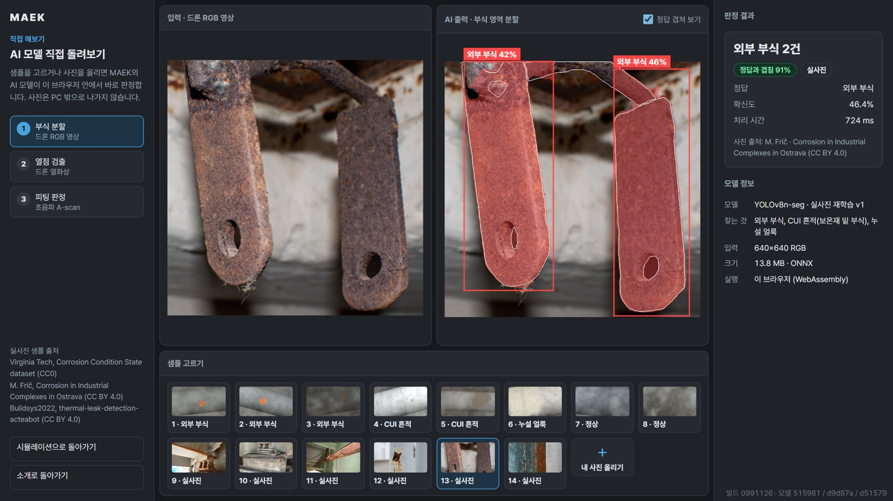
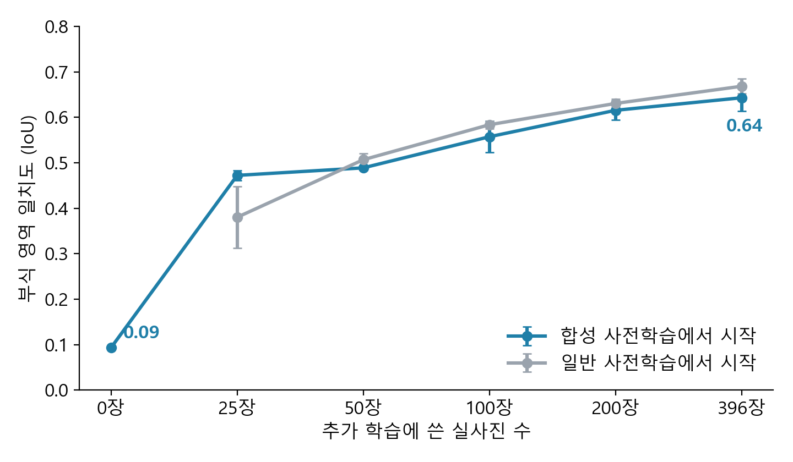
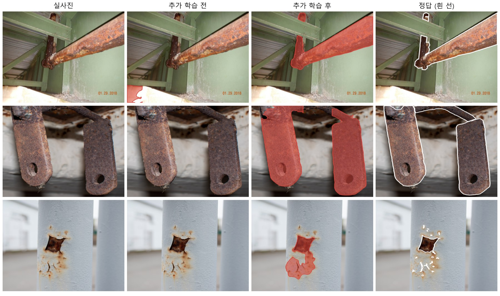
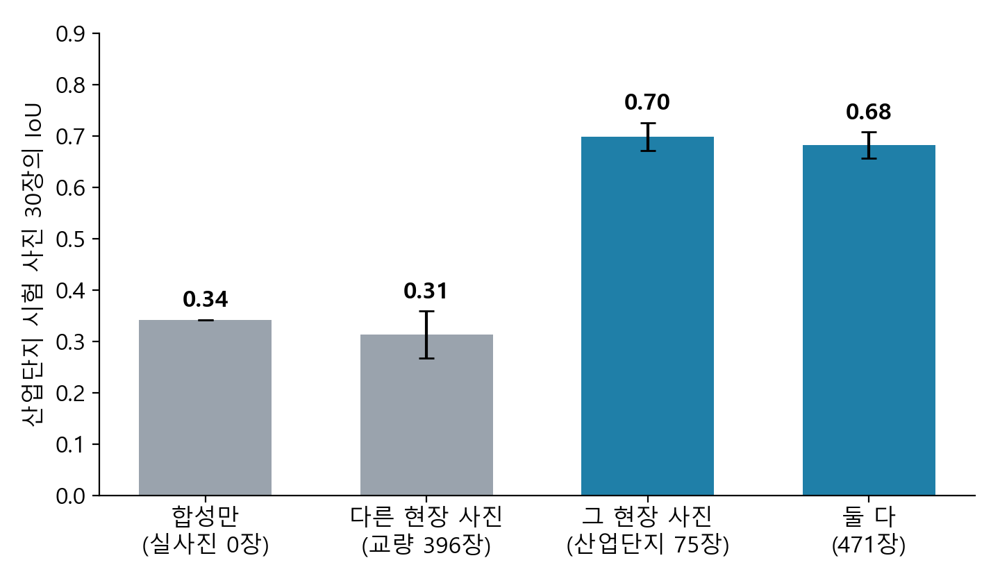
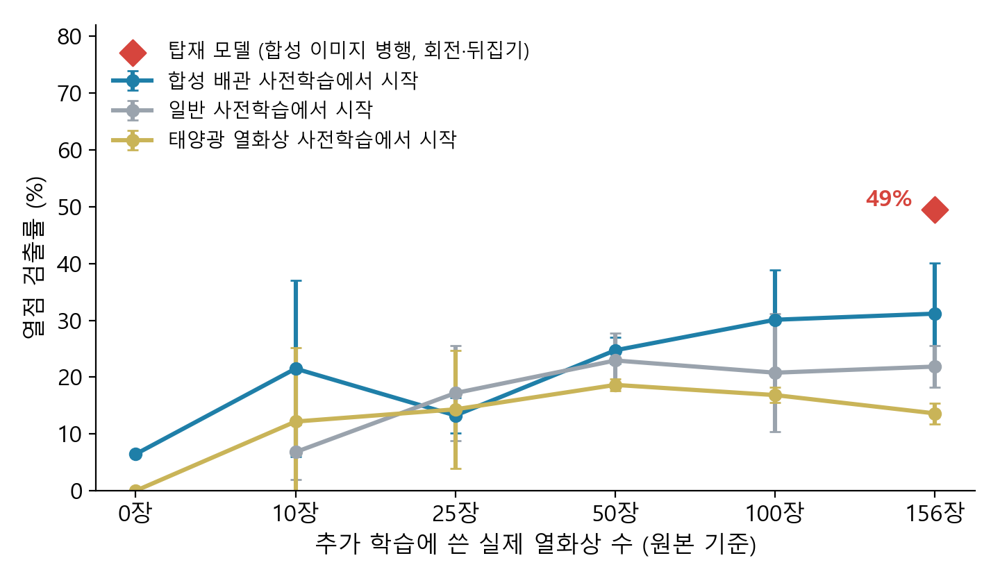
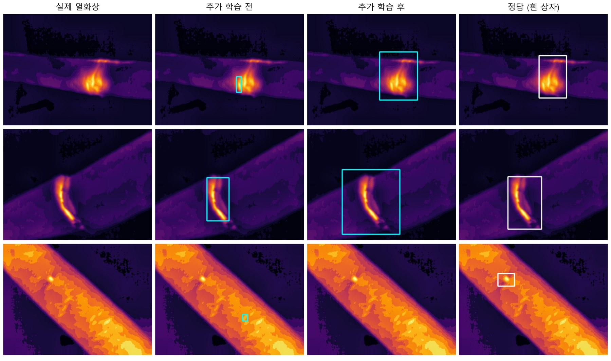
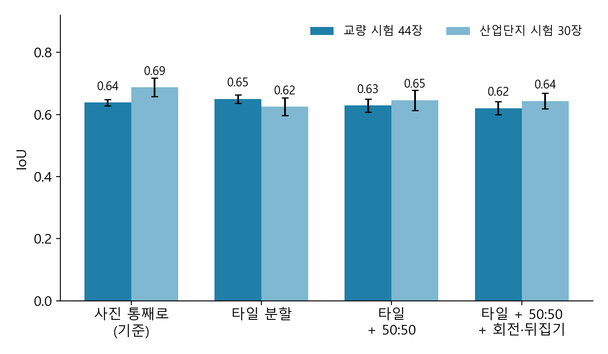

# MAEK 후속 보고

**실제 사진으로 다시 학습한 배관 판정 AI와 직접 확인하는 방법**

2026년 11월 12일 · MAEK 팀 최재영 · 2026 POSCO AI 해커톤 후속

## 요약

> **해커톤에서 보여 드린 AI는 합성 영상으로만 학습해서 실제 사진에서는 거의 동작하지 않았습니다. 공개된 실제 사진 수백 장으로 다시 학습하자 실제 사진에서 동작하기 시작했고, 효과는 같은 현장의 사진을 넣었을 때 가장 컸습니다.**
>
> 심사 때 현장 전문가께서 주신 "그 환경에 맞는 데이터를 만들라"는 말씀이 실험 숫자로 확인됐습니다.

| 확인한 것 (학습에 쓰지 않은 실제 사진) | 다시 학습하기 전 | 다시 학습한 후 |
|---|---|---|
| 부식 영역 일치도, 산업단지 사진 30장 | 0.34 | **0.66** |
| 부식 영역 일치도, 교량 사진 44장 | 0.04 | **0.62** |
| 열화상 열점 검출률, 배관 열화상 93장 | 6% | **49%** |
| 열화상 오경보, 사진 1장당 | 2.57건 | **0.23건** |

*영역 일치도(IoU): AI가 칠한 부식 영역과 정답 영역이 겹치는 비율. 1이면 완전히 같습니다.*

**같은 현장의 사진이 중요했습니다.** 산업단지 사진에서의 일치도는 교량 사진 396장으로 학습하면 0.31, 산업단지 사진 75장으로 학습하면 0.70이었습니다.

**아직 부족한 점**

- 실제 사진은 모두 공개 자료입니다. 포스코 현장 사진이 아닙니다.
- 열화상 검출률 49%는 현장에서 쓰기에 부족합니다.
- 초음파 모델은 실제 신호 자료를 구하지 못해 해커톤 때 그대로입니다.

**직접 확인하실 수 있습니다.** 웹페이지 https://nalziori.github.io/MAEK/ 를 열거나, 함께 보내 드린 MAEK_offline.zip을 풀고 START.bat을 실행하시면 됩니다. 자세한 방법은 다음 쪽에 있습니다.

## 1. 직접 확인하는 방법

**아래 세 가지 방법은 모두 같은 모델과 같은 샘플을 쓰므로 같은 결과가 나옵니다.**

| 방법 | 필요한 것 | 여는 법 |
|---|---|---|
| 웹페이지 | 브라우저 (Chrome, Edge) | https://nalziori.github.io/MAEK/ |
| 오프라인 ZIP | 없음 (설치·인터넷 불필요) | 함께 보내 드린 MAEK_offline.zip을 풀고 START.bat 실행 |
| 저장소를 받아 실행 | Python 3.10 | https://github.com/nalziori/MAEK 의 docs/local-setup.md 순서대로 |

세 가지 방법 모두 화면 구성이 같습니다. 소개 화면, 2분짜리 고로 부생가스 배관 점검 시뮬레이션, 그리고 AI 모델을 직접 돌려 보는 화면으로 이어집니다.

- **샘플로 확인:** 합성 영상과 실제 사진 샘플을 누르면 AI가 그 자리에서 판정합니다. 실제 사진 샘플은 시험용 사진에서 일정한 간격으로 골랐고, 맞힌 것만 고르지 않았습니다. 틀린 결과도 그대로 보입니다.
- **내 사진으로 확인:** "내 사진 올리기"로 가지고 계신 사진을 넣을 수 있습니다. 판정은 브라우저 안에서만 이뤄지고 사진은 PC 밖으로 나가지 않습니다.
- **따로 받을 파일은 없습니다.** 저장소에는 .env나 비공개 설정 파일이 없고, 모델 파일은 저장소와 GitHub Release에 공개돼 있습니다.

*AI 모델 직접 돌려보기 화면. 실제 산업단지 사진에서 부식 영역을 칠한 결과입니다(흰 선은 정답).*

**같은 결과인지 확인한 내용**

| 확인 항목 | 결과 |
|---|---|
| 웹 화면 자동 검증 (소개, 시뮬레이션, 모델 화면, 사진 올리기) | 36개 항목 모두 통과 |
| 오프라인 ZIP: Python이 없는 조건에서 START.bat과 같은 방식으로 실행 | 같은 36개 항목 모두 통과 |
| 저장소 직접 실행: 새 Python 3.10 환경에서 설치부터 실행 | 샘플 33건 모두 웹과 같은 결과 |
| 세 방법의 모델 파일 | 같은 파일 (화면 오른쪽 아래 버전 표시로 대조 가능) |

다른 PC에서 실제로 열어 본 것은 아닙니다. 사내 보안 프로그램이 START.bat 실행을 막으면 웹페이지로 확인하시면 됩니다.

## 2. 해커톤에서 받은 지적과 조치

| 받은 지적 | 한 일 | 결과 |
|---|---|---|
| 현장마다 환경이 다르다. 그 환경에 맞는 데이터를 만들어라 (현장 전문가) | 다른 현장 사진과 같은 현장 사진을 각각 넣어 비교 | 같은 현장 사진 75장이 다른 현장 사진 396장보다 효과가 컸음 (0.70 대 0.31) |
| 제철소에서 드론은 어렵다. 스마트 글라스나 케이블 카메라도 있다 (현장 전문가, 심사위원) | 모델은 카메라 종류를 가리지 않으므로, 어떤 사진이든 올려서 판정하는 기능을 추가 | 웹과 ZIP에서 사진 올리기 가능. 드론 시뮬레이션은 한 가지 예시로 유지 |
| 사진을 겹치게 나눠 정상 자료를 확보하고 정상과 결함을 50:50으로 맞춰라 (교수님) | 20% 겹치게 640픽셀로 나누고 50:50으로 맞춰 학습 | 일치도 차이가 실험 오차 안이라 효과를 확인하지 못함. 3.4절 참고 |
| 부식 여부가 아니라 심각도를 판단해라 (교수님) | 심각도 3단계 정답으로 학습 | 사진 396장으로는 부족 (가장 심한 단계 일치도 0.08). 탑재하지 않음 |
| 한 번 보고 판단하지 말고 계속 관찰해라. 순환 신경망 등 (교수님) | 하지 못함 | 같은 지점을 반복해 찍은 자료가 없음. 시범 적용 때 수집을 제안 |
| 촬영 각도를 보정해라 (교수님) | 회전과 뒤집기를 섞어 학습하는 데 그침 | 각도 보정 자체는 하지 못함 |
| 어떤 배관인지 구분이 없다 (현장 전문가) | 하지 못함 | 가상 공장 자료에 배관별 유체와 점검 항목이 있어 연결할 수 있음 |
| 소개 영상이 느리다 (심사위원) | 웹 소개 영상을 1.5배속으로 시작 | 반영 |
| 실제로 구현한 것인지 확인하기 어렵다 (심사위원) | 누구나 실행할 수 있게 세 가지 방법으로 공개 | 1절 참고 |

## 3. 결과

### 3.1 실제 사진을 넣으면 얼마나 좋아지는가 (부식)

**실제 사진 25장만 넣어도 크게 오르고, 장수가 늘수록 계속 오릅니다.** 교량 사진을 0장에서 396장까지 늘려 가며 다시 학습하고, 학습에 쓰지 않은 교량 사진 44장으로 쟀습니다. 조건마다 세 번씩 돌린 평균입니다.

*실제 사진 수에 따른 부식 영역 일치도. 세로 막대는 세 번 돌린 결과의 편차입니다.*

- 합성 영상으로 먼저 학습해 둔 모델(파란 선)은 실제 사진이 적을 때 유리했습니다. 25장일 때 0.47 대 0.38입니다.
- 실제 사진이 100장 이상이면 차이가 없거나 일반 사전학습 쪽이 조금 높습니다(396장에서 0.64 대 0.67). 합성 영상 학습의 가치는 현장 사진이 적은 초기에 있습니다.

*학습에 쓰지 않은 실제 사진에서의 결과. 붉은 영역이 AI가 찾은 부식입니다. 맨 아래 사진처럼 작은 녹 자국은 아직 놓칩니다.*

### 3.2 같은 현장의 사진이 필요하다

**다른 현장의 사진은 많이 넣어도 도움이 되지 않았고, 같은 현장의 사진은 적게 넣어도 효과가 컸습니다.** 체코 산업단지 사진 30장을 시험용으로 떼어 두고 네 가지 모델을 비교했습니다.

*산업단지 시험 사진에서의 부식 영역 일치도. 교량 사진 396장은 효과가 없었고, 산업단지 사진 75장은 0.70까지 올렸습니다.*

포스코 현장에 적용하려면 공개 사진을 더 모으기보다 현장 사진을 소량이라도 확보하는 것이 먼저라는 뜻입니다.

### 3.3 열화상

**오경보는 크게 줄었지만 검출률은 아직 절반입니다.** 실제 배관과 덕트를 가까이서 찍은 공개 열화상으로 다시 학습했습니다. 시험은 학습에 쓰지 않은 다른 촬영분 93장으로 했습니다.

*실제 열화상 수에 따른 열점 검출률. 합성 배관 영상으로 먼저 학습한 모델(파란 선)이 가장 높았습니다.*

- 합성 배관 영상으로 먼저 학습한 모델이 25장 조건을 빼고는 다른 출발점보다 높았습니다(156장에서 31% 대 22%). 열화상에서는 합성 학습이 도움이 됐습니다.
- 탑재 모델은 검출률 49%, 사진 1장당 오경보 0.23건입니다. 다시 학습하기 전에는 6%, 2.57건이었습니다.
- 시험용 촬영분은 학습용과 장면이 많이 달라 어려운 조건입니다. 그래도 절반을 놓치는 수준이므로 현장 열화상이 더 필요합니다.

*학습에 쓰지 않은 실제 열화상에서의 결과(하늘색 상자). 맨 아래처럼 작은 열점은 놓쳤습니다.*

### 3.4 전처리, 50:50 균형, 심각도 제안을 적용한 결과

**제안해 주신 방법을 적용했지만, 이번 시험 사진으로는 효과를 확인하지 못했습니다.** 같은 사진(교량 396장과 산업단지 75장)을 네 가지 방식으로 학습해 비교했습니다.

*학습 방식에 따른 부식 영역 일치도. 네 방식의 차이가 세 번 돌린 편차(약 0.03) 안에 있습니다.*

- 사진을 나누면 부식 타일 3,455개에 정상 타일 845개가 나왔습니다. 말씀하신 대로 정상 자료가 부족했고, 정상 타일을 반복해 넣어 50:50을 맞췄습니다.
- 50:50 균형은 주로 정상 사진에서 잘못 울리는 경보를 줄이는 방법입니다. 그런데 이번 실제 사진 시험 자료에는 정상 사진이 없어 그 효과를 잴 수 없었습니다. 효과가 없다고 결론 내릴 수는 없습니다.
- 사진을 나눠 학습한 모델은 큰 사진을 나눠서 판정할 때 더 잘 맞았습니다(교량 0.64 대 0.50). 고해상도 현장 사진에서는 의미가 있을 수 있습니다.
- 심각도 3단계 학습은 일치도가 보통 0.35, 나쁨 0.35, 심각 0.08로 낮았습니다. 심각 단계 사진이 적어서이며, 현장 전문가의 심각도 표시가 더 필요합니다.

### 3.5 탑재한 모델

**실제 사진 성능을 올리면서 기존 합성 영상 성능도 지켰습니다.** 실제 사진만으로 다시 학습하면 합성 영상에서의 일치도가 0.87에서 0.34~0.49로 떨어졌습니다. 합성 영상 600장을 함께 넣어 학습해 이를 막았습니다.

| 모델 | 시험 자료 | 전 | 후 |
|---|---|---|---|
| 부식 | 교량 실제 사진 44장, 일치도 | 0.04 | 0.62 |
| 부식 | 산업단지 실제 사진 30장, 일치도 | 0.34 | 0.66 |
| 부식 | 합성 영상 200장, 일치도 | 0.87 | 0.82 |
| 부식 | 합성 정상 영상 80장 중 잘못 울린 비율 | 3.7% | 5.0% |
| 열화상 | 실제 열화상 93장, 검출률 | 6% | 49% |
| 열화상 | 실제 열화상 93장, 사진 1장당 오경보 | 2.57건 | 0.23건 |
| 열화상 | 합성 영상 200장, 검출률 | 95% | 93% |
| 초음파 피팅 | 바꾸지 않음 (합성 신호 기준 검출률 96.7~99.7%, 오경보 0~0.8%) |  |  |

*3.1절의 그래프는 512픽셀로 줄인 사진으로, 이 표는 원본 해상도 사진으로 쟀습니다. 그래서 교량 사진의 "전" 값이 그래프(0.09)와 표(0.04)에서 다릅니다.*

## 4. 한계

- **현장 자료가 아닙니다.** 실제 사진은 미국 교량 점검 사진, 체코 산업단지 사진, 건물 공조 설비 열화상입니다. 제철소 배관에서 같은 숫자가 나온다고 말할 수 없습니다.
- **실제 사진에서의 오경보율을 재지 못했습니다.** 시험용 실제 사진에 정상 사진이 없기 때문입니다.
- **시험 사진이 적습니다.** 44장, 30장, 93장이라 숫자가 몇 장의 결과에 따라 흔들립니다.
- **탑재 모델은 한 번만 학습했습니다.** 비교 실험은 조건마다 세 번씩 돌렸지만 탑재 모델은 한 번입니다.
- **초음파 모델과 드론 탑재 장비(Jetson) 측정은 이번 작업 범위가 아닙니다.** Jetson 측정 자료는 제가 확인하지 못해 이 보고서에 싣지 않았습니다.

## 5. 다음 단계 제안: 현장 한 구역 시범 적용

**현장 한 구역의 사진 100~200장으로 같은 실험을 해 보는 것을 제안드립니다.** 공개 자료에서는 같은 현장 사진 75장으로 일치도가 0.34에서 0.70으로 올랐습니다. 포스코 현장에서도 그런지는 해 봐야 압니다.

| 항목 | 제안 내용 |
|---|---|
| 대상 | 한 구역, 한 종류의 배관 (예: 고로 가스 청정 구역의 부생가스 배관) |
| 필요한 자료 | 부식 사진 100~200장과 같은 수의 정상 사진, 열화상 100~200장. 촬영 수단은 무엇이든 가능 (스마트 글라스, 고정 카메라, 휴대폰) |
| 함께 모으면 좋은 것 | 같은 지점을 날짜를 달리해 찍은 사진(변화 추적용), 전문가의 심각도 표시 |
| 하는 일 | 정답 표시, 다시 학습, 떼어 둔 현장 사진으로 검출률과 오경보율 측정 |
| 기간 (추정) | 자료 수령 후 2~3주 |
| 성공 기준 | 시작 전에 현장과 함께 정함 (예: 검출률과 오경보율 목표) |

## 부록. 자료 출처와 재현 정보

| 자료 | 내용 | 라이선스 |
|---|---|---|
| Corrosion Condition State Semantic Segmentation Dataset (Virginia Tech) | 교량 점검 사진 440장, 부식 영역과 심각도 표시 | CC0 |
| Corrosion in Industrial Complexes in Ostrava (M. Frič, Zenodo) | 체코 오스트라바 산업단지 부식 사진 105장 | CC BY 4.0 |
| thermal-leak-detection-acteabot (Buildsys2022, Roboflow) | 보온 배관·덕트의 실제 열화상, 열이 새는 지점 표시 | CC BY 4.0 |

- 실험: 학습과 평가를 모두 106회 실행했습니다(RTX 4090 1대). 실행한 스크립트, 전체 결과, 자료 해시는 저장소의 experiments/real_adaptation 폴더에 있습니다.
- 모델 파일: GitHub Release models-20261112 (maek_corrosion_real_v1, maek_thermal_real_v1, 해시 포함).
- 판정 기준(확신도 0.25)과 학습 횟수는 결과를 보기 전에 정했고, 시험 사진은 모델을 고르는 데 쓰지 않았습니다.
- 열화상 공개 자료는 같은 사진이 학습용과 시험용에 겹쳐 있어서, 촬영분 단위로 다시 나눠 겹치지 않게 했습니다. 이 자료에는 표시 항목의 설명이 없어서, 샘플을 보고 열이 새는 지점으로 판단한 네 항목만 썼습니다.

