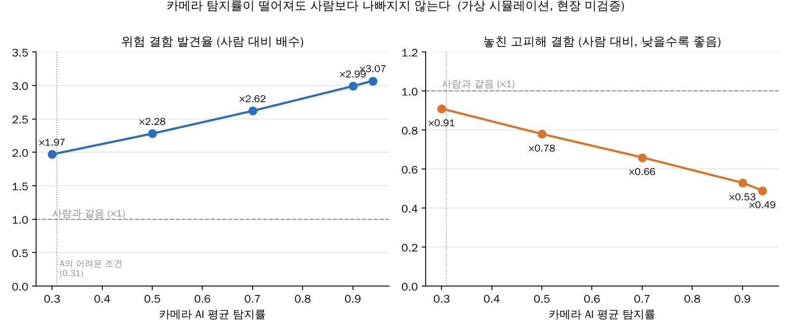
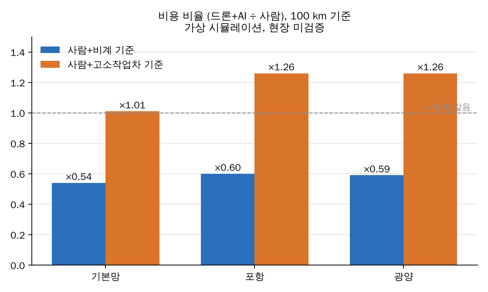
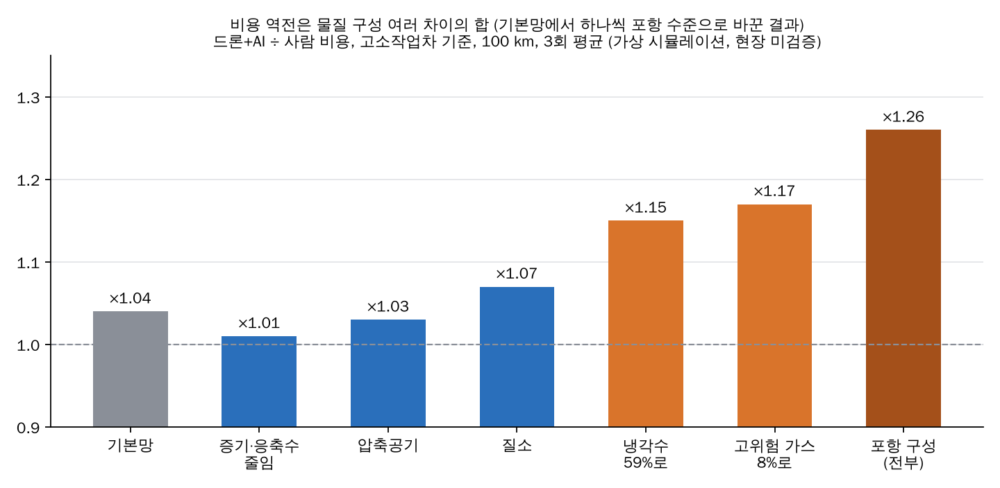

# 탐지률 스윕, 포항·광양, 비용 역전 분석 결과

> 모든 수치는 가상 시뮬레이션 결과이며 현장 미검증입니다. 배관 길이와 물질 비율은 공개 자료로 추정한 가정값입니다 (실제 설비 목록 아님). AI 개발비는 시뮬레이션 비용에 포함하지 않았습니다.

## 1. 한 줄 결론
- 같은 비용 수준에서 위험 결함을 약 3배 찾고, 놓치는 고피해 결함은 약 절반으로 줄입니다.
- 비용은 AI 성능이 아니라 **사람이 어떻게 접근하느냐(비계 / 고소작업차)** 가 결정합니다. 비계 기준 약 −40%, 고소작업차 기준 약 +26%.
- "비용 40% 절감"만 단독으로 말하지 않습니다.

## 2. 탐지률 스윕 (100 km 가상망, 20회 평균, 고정 시드 1)
"AI 탐지률이 X면 결과가 Y"를 보는 곡선입니다. 가로축은 시뮬레이션 결함 전체의 평균 탐지률입니다.

### 2-1. 카메라 AI
| 카메라 평균 탐지률 | 위험 결함 발견율 (사람 대비 배수) | 놓친 고피해 결함 (사람 대비) |
|---|---|---|
| 0.3 | ×1.97 | ×0.91 |
| 0.5 | ×2.28 | ×0.78 |
| 0.7 | ×2.62 | ×0.66 |
| 0.9 | ×2.99 | ×0.53 |
| 현재 가정 (0.94) | ×3.07 | ×0.49 |

- 비용 비율(드론+AI ÷ 사람)은 탐지률이 바뀌어도 거의 그대로입니다: 비계 기준 0.53~0.54, 고소작업차 기준 0.95~1.015.

- 탐지률이 0.3까지 내려가도 사람보다 나빠지지 않습니다 (×1.97). 카메라는 의심 지점만 골라 주고, 초음파·PEC가 받쳐 줍니다.
- 단, 외부 부식 한 가지만 보면 카메라 탐지률 0.3에서 0.13으로 사람(0.50)보다 낮습니다.
- 시뮬레이터 기본 가정(0.94)과 카메라 AI 어려운 조건(HSV 이동) 결과(0.31)에 차이가 있어, 두 값을 모두 곡선 위에 표시합니다.

### 2-2. 초음파 AI: 균열·피팅 따로
| 대상 | AI 탐지률 0.3 → 0.9 | 전체 발견율 | 비교 |
|---|---|---|---|
| 균열 | 균열 발견율 0.13 → 0.18 | 거의 변화 없음 (약 ×3.06) | 사람 0.00 |
| 피팅(구멍 부식) | 0.026 → 0.051 | 거의 변화 없음 | 사람 0.040, AI 탐지률이 약 0.6을 넘어야 사람보다 나음 |

- 초음파 AI는 전체 숫자를 거의 안 움직입니다. 결함별 수치로 보여야 합니다.
- 균열 발견율이 낮은 이유는 AI 성능이 아니라 측정 지점 예산(용접부 샘플 5%, 균열 초음파 예산 30%) 때문입니다.
- 균열은 20 km에서는 결함이 너무 적어 0이 나옵니다. 반드시 100 km로 봐야 합니다.

## 3. 포항·광양 결과 (사람 → 드론+AI)
| 사이트 | 길이 | 위험 결함 수 | 발견율 | 놓친 고피해 결함 | 비용 비계 (억 원) | 비용 고소작업차 (억 원) |
|---|---|---|---|---|---|---|
| 포항 | 770.5 km | 1,716 | 0.170 → 0.576 (×3.39) | 77 → 35개 | 277 → 164 (×0.59) | 65 → 82 (×1.26) |
| 광양 | 1,064.8 km | 2,368 | 0.172 → 0.582 (×3.39) | 95 → 43개 | 384 → 229 (×0.60) | 90 → 113 (×1.26) |

- 소요 일수: 비계 약 ×0.67, 고소작업차 ×1.33.
- 놓친 고피해 결함의 개수가 기본망(100 km당 39.6개)보다 적은 것(포항 10.0, 광양 9.1)은 위험 5등급 물질이 약 8%로 기본망(30%)보다 적기 때문입니다. 개수가 아니라 비율로 말합니다.

### 100 km 기준 구성 비교
| 구성 | 접근 | 발견율 | 비용 (억 원, 사람 → 드론+AI) |
|---|---|---|---|
| 기본망 | 비계 | 0.192 → 0.587 (×3.06) | 35.3 → 19.2 (×0.54) |
| 포항 | 비계 | 0.171 → 0.582 (×3.40) | 36.1 → 21.5 (×0.60) |
| 광양 | 비계 | 0.169 → 0.588 (×3.48) | 36.1 → 21.5 (×0.59) |
| 기본망 | 고소작업차 | 0.192 → 0.587 | 8.6 → 8.7 (×1.01) |
| 포항 | 고소작업차 | 0.171 → 0.582 | 8.5 → 10.6 (×1.26) |
| 광양 | 고소작업차 | 0.169 → 0.588 | 8.5 → 10.6 (×1.26) |

## 4. 비용 역전 (고소작업차에서 ×1.01 → ×1.26): 원인과 발표에서 말하는 법
**한 줄:** 역전은 AI 성능 때문이 아니라 "싼 고소작업차를 비교 기준으로 잡은 것"과 "배관 물질 구성"에서 나옵니다. 같은 100 km에서도 구성만 바꾸면 ×1.01~×1.26으로 움직입니다.

### 4-1. 돈이 어디서 늘었나 (비용 항목 분해)
- 같은 100 km에서 물질 구성만 포항 수준으로 바꿔도 역전이 재현됩니다 (기본 ×1.04 → 포항 구성 ×1.26). 원인은 배관 길이(규모)가 아니라 **물질 구성**입니다.
- 비용 항목 중 가장 크게 바뀌는 것은 **보온재 해체**(초음파 센서를 금속 표면에 대려고 단열재를 뜯는 작업)입니다. 포항에서 드론+AI의 해체 개수가 사람보다 많아집니다 (포항 AI 2,328 vs 사람 2,038, 기본망 AI 1,770 vs 사람 2,116).
- 항목을 하나씩 기본망 값으로 되돌려 보는 검사 (포항 구성 드론+AI의 해당 항목만 기본망 값으로 바꿨을 때의 비용 비율. 현재 ×1.26이고, 많이 내려갈수록 그 항목의 기여가 큼): 보온재 해체 ×1.13, 초음파 점 장비 ×1.22, 인건비 ×1.22, 고소작업차 ×1.25, 나머지(드론 촬영, AI 처리, PEC, 드론 접촉 초음파, 비계) 변화 없음. 보온재 해체의 몫이 가장 큽니다.
- 고소작업차 일수, PEC 장비비는 차이가 거의 없고, 드론 접촉 초음파와 드론 촬영비는 양쪽 같은 수준입니다.

### 4-2. 어떤 배관 구성 때문인가 (물질 비율을 하나씩 바꾼 실험)
100 km, 고소작업차, 3회 평균, 드론+AI ÷ 사람 비용. 기본망에서 해당 물질만 포항 수준으로 바꿨습니다.

| 바꾼 것 | 비용 비율 |
|---|---|
| (기본망 그대로) | ×1.04 |
| 고위험 가스(CO가스·산소·불산)를 약 8%로 줄임 | ×1.17 |
| 냉각수(물 계통)를 59%로 올림 | ×1.15 |
| 질소 | ×1.07 |
| 압축공기 | ×1.03 |
| 증기·응축수 | ×1.01 |
| 포항 구성 전부 | ×1.26 |
| 포항 구성에서 냉각수만 25%로 되돌림 | ×1.10 |

- 한 가지가 단독 원인이 아니라 **여러 비율 차이가 함께** 만든 결과입니다 (효과가 서로 겹쳐서 단순 합은 아닙니다).
- 냉각수 증가의 경우 코드 분석상 메커니즘은 이렇습니다: 물 계통에는 얇아지기 쉬운 지점이 많아 (1,140 → 1,805개, 그중 보온재 있는 지점 750 → 976개) 드론+AI가 초음파를 더 많이 재고, 보온재가 있으면 지점마다 해체가 필요합니다. 고위험 가스가 줄면 왜 상대 비용이 오르는지는 확인하지 못했습니다.
- 물질 비율은 공개 자료 기반 **가정값**입니다 (5절). 비율을 바꾸면 결과가 바뀝니다.

### 4-3. 발표에서 말하는 법
- "비용은 접근 방식과 배관 구성에 따라 −40%(비계)에서 +26%(고소작업차)까지 달라집니다. 위험 결함 발견은 어느 경우든 약 3배입니다."
- "비용 40% 절감"만 단독으로 말하지 않습니다.
- 이 분석은 새 주장이 아니라, 이미 있는 ×1.26 숫자에 대한 질의응답용 방어 논리입니다.

## 5. 가정의 근거 (질문 대비)
- 길이: 부지 면적(포항 8.9 km², 광양 13.7 km², 포스코 공시), 고로 수(3기, 5기), 해외 제철소 디지털 트윈 사례(voestalpine)로 추정했습니다.
- 물질 비율: 가스 7종은 부지 폭·고로 수 식으로 계산했고, 나머지는 물 48% / 폐수 16% / 증기 14% / 공기·화학약품 22%로 나눈 **가정**입니다. 근거 출처가 없는 가장 약한 값입니다.
- 비율을 바꿔도 발견율 약 3배는 유지됩니다 (민감도 ×3.2~×3.5).
- 자세한 내용: 레포 `docs/pipe-length-mapping.md`, `docs/results.md`, `docs/robustness.md`, `posco_pipe_length_scenario_2026-11-06.json`.

## 재현 방법
- 탐지률 스윕: `OMP_NUM_THREADS=1 python scripts/pod_sweep.py` (100 km, 20회, 약 3시간)
- 비용 역전 항목 분해: `python scripts/cost_reversal.py --runs 3`
- 물질 비율 실험: `python -m maek strategy --runs 3 --total-km 100 --seed 1 --set strategy.human_elevated_access=lift --set network.media_mix.cooling_water=0.588`
