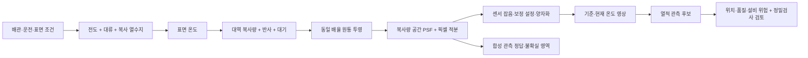

# MAEK: 원자료를 추적할 수 있는 합성 열화상 v2

> 공개 범위: 이 문서는 2026-11-08~09 개발 작업본의 설계·실험 기록입니다. 아래의 구현·검증 기록은 해당 작업본 기준이며, 이 문서 PR은 관련 코드·설정·학습 자료·실험 산출물을 포함하지 않습니다. 공개 저장소에서 제공하지 않는 자료는 링크 대신 경로로 표시했습니다. 실행 예시는 해당 개발 환경이 있어야 하며, main의 배포 기능이나 현장 검증 결과를 뜻하지 않습니다.

작성·확인일: 2026-11-08.

목표는 가스 배관의 정밀검사 후보를 놓치지 않고 선별하는 MAEK에 필요한 **위치가 있는 열적 관측과 입력 품질 판단**이다. 문헌의 방정식, 특정 센서의 사양, 현장 조건의 가정, 실제 검증 결과를 분리한다. 합성 영상을 실측으로 표시하지 않는다.

## 원자료에서 무엇을 가져왔는가

| 근거 | 가져온 내용 | 가져오지 않은 주장 |
|---|---|---|
| [NIST 광학 계측 교육자료](https://www.nist.gov/system/files/documents/iaao/SIM-Metrology-School-Optical-Metrology-Y-Ohno-2.pdf), slide17; [NIST SI 정의](https://www.nist.gov/pml/special-publication-330/sp-330-section-2) | Planck 분광 복사휘도식, 현재 SI의 h·c·k | 특정 카메라의 실측 분광 응답·교정 정확도 |
| [FLIR 계측식 원문](https://support.flir.com/docdownload/assets/dl/t559495-en-us%24aa.pdf), §13 식2–3 | 표면 방출·주변 반사·대기 방출과 투과율의 결합 | 재질별 방사율이나 거리·습도별 투과율을 측정했다는 주장 |
| [FLIR A70 정확한 SKU 사양](https://support.flir.com/dsdownload/assets/89929-0101-en-us.html), P/N89929-0101 rev93980 | 대표 대역의 양 끝 7.5–14µm | 128×160 합성 카메라가 실제 A70이라는 주장. NETD35mK를 모든 픽셀의 Gaussian σ로 변환하지 않음 |
| [NISTIR8098](https://doi.org/10.6028/NIST.IR.8098) | 교정·방사율·공간 응답을 구분해 다룰 필요성 | 보고서의 고온 NIR 예시 수치를 LWIR 배관 조건에 전용 |
| [MIT 원통 전도·대류](https://web.mit.edu/16.unified/www/FALL/thermodynamics/notes/node123.html), [복사 열수지](https://web.mit.edu/16.unified/www/FALL/thermodynamics/notes/node136.html) | 원통 열저항, 대류 경계, 회색 표면의 T⁴ 복사 열교환 | 현장 유동·재질·바람·일사 조건이나 축약 셸 모델의 실측 타당성 |
| [NASA 감육 열화상 원논문](https://ntrs.nasa.gov/api/citations/20040086056/downloads/20040086056.pdf), [TWI 기법 설명](https://www.twi-global.com/what-we-do/services-and-support/asset-management/non-destructive-testing/ndt-techniques/thermography) | 능동 여기·표면 처리·보정 조건을 구분하는 근거 | 외부 가열을 사용한 결함 검출 성능을 MAEK 수동 촬영에 적용 |

구체적인 접근 범위·판본·조건은 센서 근거 검토 (`thermal-evidence-sensor-model.md`, 별도 개발 자료), 손상 관측가능성 검토 (`thermal-evidence-damage-observability.md`, 별도 개발 자료)에 기록했다. 접근이 차단된 논문은 초록/색인 확인 범위로 표시한다. 데이터의 `evidence-ledger.json`은 식→출처, 설정값→근거 상태를 연결한다.

## 생성 구조



1. 기존 정상상태 셸 모델에 외부 **대류와 복사를 별도로** 넣었다. 방사율을 바꾸면 실제 표면 온도도 다시 계산한다. 복사계수를 유효 대류계수에 중복 가산하지 않는다.
2. 전 파장의 T⁴ 값으로 카메라 온도를 근사하던 부분을 **7.5–14µm Planck 적분**으로 바꿨다. 현재 대역 내 응답은 평탄하다고 가정한다. 흑체·반사·대기 항의 극한과 독립 적분식을 검사했다.
3. 표면 각도는 `sin(theta)`로 직교 투영한다. 보온 외장 반지름과 길이에 **같은 pixel/m 배율**을 적용한다. 2배 격자에서 복사량을 흐린 뒤 픽셀 면적으로 평균한다. 초점거리·거리와 연결한 실제 카메라 투영은 아직 아니다.
4. 측정값에는 복사량 영역의 독립 read noise, 공통 gain/offset, 픽셀·행 고정 패턴, 양자화·불량 픽셀을 넣었다. 각 숫자·분포는 실측한 센서 오차가 아니라 명시한 민감도 가정이다. 두 프레임의 공통 오차와 바뀌는 오차를 분리했다.
5. 감육·대류 변화·반사 변화·코팅 변화·동일 장면 반복을 같은 장면에 교차한다. **원인은 학습 정답이 아니다.** 원인 메타데이터·무잡음 영상·실제 두께·배관 마스크는 감사 전용이다.

## 데이터와 라벨 계약

기본 설정은 thermal-evidence-v2.json (`../config/thermal-evidence-v2.json`, 별도 개발 자료)이다. 장면당 정상 입력 5쌍과 품질 거절 fixture2쌍을 생성한다. train96/dev24/test24/stress24개 장면으로 총840개 관측 쌍과336개 품질 fixture를 만든다. 모든 파일은 `synthetic`이며 현장 검증 여부는 false다.

24개 요인 조합은 보온2 × 방사율2 × 온도 구동력3(0/낮음/높음) × 잡음2다. 각 분할에 전체 조합을 포함하고, 흐림·시점·위치·패치 형상은 물리 요인의 특정 비트로 결정하지 않는다. 새 난수는 실제 현장 분포를 뜻하지 않는다. 독립 추출도 작은 표본의 우연한 상관을 없애지 못하므로 교차표를 보고한다.

| 라벨/파일 | 의미·용도 |
|---|---|
| target0 | 설정한 불확실도 아래의 변화. 건전·안전 판정이 아님 |
| target1 | 무잡음 센서 관측에서 충분히 큰 겉보기 변화. 균열·감육 확정이 아님 |
| target255 | 약한 변화·불량·포화·무효 영역. 분할 학습에서 제외 |
| `index.jsonl`, `samples/` | 품질 조건이 충족된 합성 관측 학습/평가용 |
| `quality-index.jsonl`, `quality-fixtures/` | 정합 오류·보정 드리프트의 거절 경로 검증용. 전부255이며 분할 학습 인덱스에서 제외 |
| `*_audit_only` 배열, 원인 메타데이터 | 생성 검산·물리 민감도 확인 전용. 모델 입력·규칙 입력에 제공 금지 |

임계값은 복사량 잡음이 카메라 역변환을 통과한 픽셀별 등가 온도 불확실도로 계산한다. 두 프레임 차이의 σ를 합성 잡음 가정 아래 전파한다. 낮은 문턱은 `max(σ_pair,양자화)`, 높은 문턱은 `max(3σ_pair,2×양자화)`다. 이는 라벨을 만드는 **설계 규칙**이며 현장 검출한계나 확률 보증이 아니다.

고정된 실제 표면 온도에서 반사만 바꾼 사례는 방향성 반사의 **격리 민감도 시험**이다. 방향별 반사 변화와 반구 전체의 열수지를 동시에 계산한 3D 장면으로 설명하지 않는다. 코팅 변화 사례는 회색 방사율을 바꾸고 열수지도 함께 계산한다.

## 검증 단계와 현재의 한계

1. 방정식 구현: 독립 흑체 적분/역변환, 균일 원통의 비선형 해, 무온도차 평형, 비균일 조건의 내부·외부 열류 적분을 확인한다.
2. 수치 근사: 대역·온도 적분 격자와 표면 격자의 민감도를 확인한다. 두 격자의 일치는 실제 배관 정확도와 다르다.
3. 데이터: 별도 검증기가 해시·분할·요인 조합·측정 입력 중복·라벨·품질 분리를 검사한다. 같은 장면을 여러 분할에 넣지 않는다.
4. 모델: 이후 새 프로토콜로 동일 입력·dev 오경보 조건을 고정해 규칙과 비교한다. 이번 생성 단계에서 모델 학습이나 test 성능 선택을 하지 않는다.
5. 현장: 실제 렌즈/센서 응답과 표면 조건을 보정하고, 같은 위치의 NDT 결과로 검사 우선순위의 추가 이득을 확인해야 한다.

아직 **반원 셸 단열 경계, 정상상태, 일정 물성, 보온재의 측방향 전도 생략, 공기와 복사 주변 온도 동일, 일사·유동·응력·균열 성장·누설·가스 분광 영상 생략**이 남아 있다. 현장 설비 재질/매질/운전 범위가 없는 상태에서 뽑은 `k/h/두께/방사율/투과율`은 문헌으로 인증한 범위가 아니다. 이 값을 임의로 “공신력 있는 실측 분포”로 승격하지 않는다.

따라서 이번 버전은 **원자료에 연결한 물리·계측 모델의 합성 관측 학습 데이터**다. “실제 데이터와 동등함”, “균열 임박 예측 가능”, “사고 예방 정확도 검증 완료”의 근거로 사용할 수 없다. 문헌으로 근거를 보완할 수 있는 부분과 실제 보정이 필요한 부분이 파일에 드러나도록 만들었다.

## 실행·인계

이번 생성본은 데이터 카드 (`../../outputs/maek-c/thermal-evidence-v2-20261108/DATA_CARD.md`, 별도 개발 자료)와 독립 검증 결과 (`../../outputs/maek-c/thermal-evidence-v2-20261108/validation.json`, 별도 개발 자료)에서 확인한다. 840개 관측 쌍과336개 품질 fixture의 검증, 관련146개 테스트, CPU 학습 입력·역전파1회 확인을 통과했다. 본학습·모델 성능 평가는 실행하지 않았다.

감육168쌍 중 양성 관측 픽셀이 있는 쌍은2개였으며 모두 train에 있다. dev/test/stress의 감육 양성 관측 지원은0이다. 이 분할로 **감육 양성 검출 성능을 평가할 수 없고**, 수치를 만들기 위해 감육 hotspot을 강제로 추가하지 않는다. 이는 현재 설정의 지원 범위이며 실측 감육 검출률이나 모든 수동 열화상의 한계 수치가 아니다. 관측 과제 전체에는 반사·코팅·대류 변화 양성이 존재한다.

공식 원자료 보관 목록 (`../../outputs/maek-c/thermal-evidence-source-snapshots-20261108/source-manifest.json`, 별도 개발 자료)에 NIST2개·NASA1개 PDF의 URL·취득시각·SHA256을 기록했다. 독립 복사 수치 검사 (`../../outputs/maek-c/thermal-evidence-source-snapshots-20261108/numerics-verified.json`, 별도 개발 자료)는69개 온도점에서 이상 대역 모델의 역변환 차이 최대0.000134°C를 확인했다. 이 값은 카메라 정확도가 아니다.

저장소 루트에서 실행하며, 생성 경로는 매번 새 경로여야 한다.

```powershell
.venv/Scripts/python.exe scripts/generate_thermal_evidence_dataset.py --out D:/obsd/Projects/hackerton/outputs/maek-c/thermal-evidence-v2-NEW
.venv/Scripts/python.exe scripts/validate_thermal_evidence_dataset.py --dataset D:/obsd/Projects/hackerton/outputs/maek-c/thermal-evidence-v2-NEW
.venv-benchmark/Scripts/python.exe scripts/report_thermal_evidence_dataset.py --dataset D:/obsd/Projects/hackerton/outputs/maek-c/thermal-evidence-v2-NEW
```

기존 `ThermalObservationDataset`는 검증 후 관측 인덱스만 읽어 기존3채널 입력을 만든다. **기존 v1 Colab ZIP은 v1 해시로 동결되어 있으므로 새 데이터 ZIP으로 임의 교체하면 안 된다.** v2 학습에는 데이터·검증기·프로토콜을 함께 동결한 별도 Colab 패키지가 필요하다. 생성·검증에는 GPU가 필요 없다.

MAEK 연결은 [현장 입력→정밀검사 개발 계획](field-inspection-development-plan.md)을 따른다. 열적 음성·품질 실패·위치 불명확이 기존 필수/고위험 NDT를 지우면 안 된다. 반사도 관측 변화일 수 있으므로 변화 마스크의 오경보와 **결함 검사 요청의 불필요한 비용**은 별도 지표로 평가한다.
