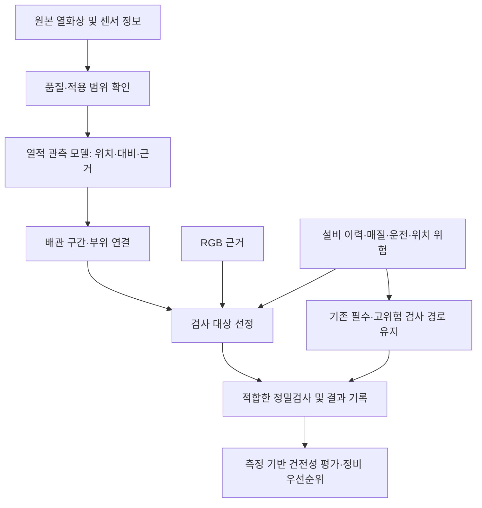

# MAEK 열화상 역할 명세와 학습 계약

> 공개 범위: 이 문서는 2026-11-08~09 개발 작업본의 설계·실험 기록입니다. 아래의 구현·검증 기록은 해당 작업본 기준이며, 이 문서 PR은 관련 코드·설정·학습 자료·실험 산출물을 포함하지 않습니다. 공개 저장소에서 제공하지 않는 자료는 링크 대신 경로로 표시했습니다. 실행 예시는 해당 개발 환경이 있어야 하며, main의 배포 기능이나 현장 검증 결과를 뜻하지 않습니다.

> 범위 정정 — 2026-11-09: 최신 프로젝트 계획서와 사용자 확인에 따라 MAEK 전체는 가스 배관
> 검사에 한정되지 않는다. 아래의 가스 배관 중심 서술은 이 문서가 작성될 당시 열화상 모듈의
> 특정 적용 사례로만 읽는다. 증기·보온 및 기타 매질의 대상 선정은 계획서와 센서 적용 조건에
> 따라 판단하며, 본 문서로 전체 제품 범위나 조사 우선순위를 좁히지 않는다.

2026-11-08. 사용자가 명시한 제품 목표에서 역산한 설계 명세다. 현재 구현 상태와 개발 목표를 구분한다. 이 문서는 기존 증기 배관 3클래스 성능표의 의미를 바꾸지 않는다.

## 1. 최종 목적과 열화상의 책임

MAEK의 최종 목적은 가스 배관의 균열·감육 등 누출·파손 위험이 있는 구간을 조기에 선별하고, 필요한 정밀검사와 정비의 우선순위를 정해 사고 예방을 지원하면서 검사 비용을 줄이는 것이다. 사고 감소나 비용 절감은 검증해야 할 결과이며 현재 달성했다고 가정하지 않는다.

**열화상 모델의 역할: 촬영 범위에서 관측되는 국부 열적 이상과 시간 변화의 위치·범위·강도 및 판독 품질을 추출하고, 실제 배관 구간에 연결된 검사 근거로 제공한다. 최종적으로 이 근거가 RGB·설비 이력만 사용했을 때보다 실제 균열·감육 검사 대상 선정에 도움이 되는지 검증한다.**

이상 점수는 균열 확률이 아니다. 열적 단서가 없는 균열·감육이 존재할 수 있으므로 열화상 미검출을 검사 제외 근거로 쓰지 않는다. 열화상에서 결함과 연관된 정보가 확인되지 않는 대상/조건에서는 그 부가가치를 인정하지 않고 설비 이력과 다른 검사 경로를 유지한다.

일반 수동 열화상은 표면의 열적 관측이고, 능동 가열 후 응답을 분석하는 검사는 별도 방식이다. 일반 열화상에서 증기 모양을 학습했다고 특정 가스의 누출 검출 능력이 생기지 않는다. 직접 가스 영상 검출은 가스와 맞는 파장대·장비·촬영 조건을 확인한 별도 작업으로 취급한다. [TWI 열화상 방식](https://www.twi-global.com/what-we-do/services-and-support/asset-management/non-destructive-testing/ndt-techniques/thermography), [FLIR 가스 영상 검출 범위](https://www.flir.com/discover/industrial/can-you-see-toxic-emissions-with-thermal-cameras/)

## 2. 적용 범위

우선 설계 대상은 MAEK의 가스 배관 검사 흐름이며, 노출/보온, 재질, 용접부·엘보·지지대·밸브·플랜지 등 위치 유형을 구분한다. 특정 가스·온도·센서에 모두 유효하다고 가정하지 않는다. 현장 운전/촬영 범위가 정해지기 전에는 해당 범위를 `unvalidated`로 기록한다. 증기/보온 계통은 지원되는 보조 시나리오이며 전체 제품 목표를 대신하지 않는다.

현재 저장소의 `byproduct_gas_co`, `oxygen` 등의 매질과 온도·피해등급은 시뮬레이션 설정이다. 실제 가스 조성·장비 적합성이나 현장 운전 범위의 증거가 아니다. `critical_height_frac=0.4` 등의 합성 균열 기준도 현장 합격 기준이나 안전 표준으로 전용하지 않는다.

## 3. 입력과 출력 계약

필수 입력은 원본 열화상/원시 측정값, 단위와 센서 설정, 촬영 시각, frame ID다. 배관/부위/구간 ID와 위치 연결 정보는 명시적으로 공급하거나 실제 입력에서 추정한다. 연결되지 않았으면 `unmapped`로 남겨 작업자 매핑 대상으로 전달한다. GT 좌표로 실제 위치 연결이 된 것처럼 평가하지 않는다.

RGB·과거 정상 영상·공정 상태·환경 정보는 선택 입력이다. 누락 여부를 보존한다. 시간 변화는 정합되고 운전 상태가 비교 가능한 과거 자료가 있을 때만 산출한다. 단일 프레임만 있을 때 시간 특징을 0으로 채워 “변화 없음”이라고 해석하지 않는다.

| 출력 필드 | 의미와 책임 |
|---|---|
| `frame_id`, `timestamp`, `model_version` | 원본과 사용 모델 추적 |
| `asset_id`, `segment_id`, `feature_id`, `location_status` | 물리적 검사 위치 연결. 미확인 ID는 null, 상태는 unmapped |
| `assessment_status` | anomaly_observed / no_anomaly_observed / indeterminate / unsupported_domain |
| `anomaly_regions` | 원본 좌표계의 열적 이상 영역, mask 참조, 면적·bbox. 누락/보류를 음성 마스크로 바꾸지 않음 |
| `observation_type` | local_thermal_contrast, temporal_change 등 관측 태그. 보온재 wet/손상·steam은 검증된 시나리오에서만 추가하는 보조 태그 |
| `evidence_score` | 관측 모델 점수. 균열·파손 확률로 표시하지 않음 |
| `local_delta_apparent_c` | 주변과의 겉보기 온도 차이와 배경 추정 방식. 표면 실제 온도나 두께라고 표시하지 않음 |
| `temporal_change`, `reference_frame_id` | 비교 가능한 시간 자료가 있을 때만 값 제공, 없으면 null |
| `quality_flags`, `support_status` | 포화·가림·흐림·정합 실패·미검증 조건 등의 근거. 판독 보류를 포함해 평가 |
| `evidence_refs` | 원본/마스크/온도 분포/정합 근거를 작업자가 검토할 위치 |

`crack_probability`, `remaining_wall_mm`, `failure_time`, `safe_to_operate`는 이 모듈의 출력이 아니다. 최종 검사 방법·순위·위험도는 아래의 별도 검사 대상 선정 모듈이 결정한다.

현재 `ThermalYOLO.predict`는 세 클래스 의미 마스크만 반환한다. 위 계약, 품질 상태, 물리 위치 연결, 시간 변화는 아직 구현된 기능이 아니며 구현·테스트 대상이다.

후속으로 별도 `field_inspection_pipeline` 경로에서 입력 검증·관측 보류·명시적 구간 매핑·필수검사 보존·NDT 기록 연결을 구현했다. 합성 시나리오만 지원하며 `ThermalYOLO.predict`나 실제 현장 장비를 연결한 상태는 아니다. 범위와 남은 작업은 [최종 목적 기반 개발 계획](field-inspection-development-plan.md)을 따른다.

## 4. 전체 구조와 학습 책임

### 관측 모델

처음에는 소형 분할 모델을 유지한다. 온도 정보와 주변 대비를 입력으로 이상 위치/범위를 학습한다. 결함 원인을 모르는 영역에는 원인을 억지로 붙이지 않고 관측 태그만 사용한다. 기존 wet/damage/steam 가중치는 해당 도메인의 기준선으로 보존한다. 가스 배관 관측 태그로 이름만 바꿔 사용할 수 없다.

판독 품질은 초기에 측정 가능한 규칙과 상태로 구현한다. 충분한 품질 라벨이 확보되면 학습 분류기를 비교한다. 시간 모델은 정합된 실제/검증된 시퀀스와 반복 운전 정보가 확보된 뒤 별도 추가한다. 먼저 단일 프레임 계약과 물리 위치 연결을 구현한다.

### 검사 대상 선정 모듈

열적 특징 + RGB 근거 + 부위·재질·운전·정비 이력을 결합한다. 초기에는 기존 위험 기반 규칙을 기준으로 명시적인 후보 추가/중복 제거를 구현한다. 임의 가중합을 보정된 위험 확률로 표시하지 않는다. 학습 순위 모델은 아래의 대응 정밀검사 라벨이 확보된 후 작은 표형 모델부터 검토한다.

학습 목표는 승인된 검사 기준에 따라 정밀검사가 필요한 균열·감육 구간의 선별이다. 이미 누출 중인 사례와 누출 전 결함 사례를 별도 태그로 분리한다. 누출 이후 신호로 학습한 성능을 사고 전 예방 성능으로 보고하지 않는다. 후속 검사 결과나 미래 영상은 추론 특징에 넣지 않는다.

위험 구간에 열적 단서가 없더라도 기존 위험 기반 검사 경로를 유지한다. 이 실패 유형을 평가 데이터에 반드시 포함한다. 열화상은 기존 검사를 대체하는 필수 관문이 아니다.

## 5. 정답 데이터: 두 층을 분리한다

| 라벨 층 | 필요한 정보 | 학습 용도 |
|---|---|---|
| 관측 정답 | 열적 이상 영역, 겉보기 대비, 비교 가능한 시간 변화, 가림·포화·위치 연결, 판독자/방법 | 관측 모델과 품질·위치 기능 |
| 결함 정답 | 같은 물리 위치의 검사 종류·검사 범위·검출 한계·두께/균열 크기·시간·검사자·판정 근거 | 검사 대상 선정과 실제 결함 발견 성능 |

알고리즘 임계값으로 만든 관측 마스크는 약한 라벨로 표시한다. 동일 임계값을 정답으로 삼아 그 임계값을 잘 복제하는 것만으로 실제 결함 탐지를 증명하지 않는다. 합성 결함은 생성 진실값으로 표시하고 실측 라벨과 구분한다.

필수 학습/검증 사례는 다음 네 조합이다: **열적 단서+결함 있음 / 열적 단서+검사 범위에서 결함 미검출 / 열적 단서 없음+결함 있음 / 열적 단서 없음+검사 범위에서 결함 미검출**. 미검사 구간은 unknown으로 남긴다. “결함 미검출”은 해당 검사 범위·감도에 한정된 결과이며 영구 건전 보증이 아니다.

양성 의심 지점만 정밀검사하면 미탐을 알 수 없으므로 미검출 지점도 표본 검사한다. 동일 배관·시점·운전 상태를 가능한 한 대응시킨다. 동일 구간의 시간 경과·다중 시점·증강본은 분할 경계를 넘기지 않는다. 실제 공급처/공장 또는 이후 시간 자료로 외부 검증을 따로 확보한다.

## 6. 증강의 목적과 경계

증강의 목적은 열적 단서의 위치·대비를 유지하면서 센서/환경에 따른 관측 변동을 견디게 하는 것이다. 없는 균열-온도 인과 관계를 생성하는 것은 목적이 아니다.

- 센서: 원시 단위를 보존하고 센서별 잡음·보정 잔차·포화·공간 해상도·흐림을 측정 범위로 모사한다.
- 장면: 배관 시점·크기·가림·배경·외장 반사를 다양화하되 같은 장면에서 정상/이상 대조쌍을 만든다. 증강된 모든 쌍은 같은 데이터 분할에 둔다.
- 운전: 정상 기동/정지·온도 변화와 실제 이상을 구분할 메타데이터를 갖춘다. 공정 변화만으로 생긴 열 변화는 곧바로 결함 라벨로 만들지 않는다.
- 결함: 열적 반응이 확인된 메커니즘만 물리 모델과 실측으로 생성 범위를 정한다. crack 길이/두께 값을 온도 그림에 임의로 대응시키지 않는다. 열적 무징후 결함도 전체 경로 검증에 포함한다.
- 보온재: 기존 wet/손상 증강은 해당 하위 시나리오에 유지한다. 전체 가스 배관 데이터의 클래스 비율을 기존 40/30/20/10으로 고정하지 않는다.
- 시퀀스: 실제 센서·정합·시간 변화의 모델이 없으면 정지 이미지를 흔든 것을 실제 결함 진행 시퀀스로 취급하지 않는다.

## 7. 성공 기준과 시험

### 기능 계약: 지금 구현할 수 있는 검사

| 사례 | 기대 동작 |
|---|---|
| 이상 영역과 위치 연결이 있는 입력 | 추적 가능한 열적 근거를 올바른 검사 구간으로 전달 |
| 위치 연결이 없는 입력 | unmapped와 근거를 남기고 잘못된 구간에 작업을 배정하지 않음 |
| 보류/미지원/센서 불량 | 정상으로 변환하지 않고 상태·재확인 이유를 전달 |
| 과거 영상 없음 | 시간 변화는 null; 변화 없음이라는 증거로 사용하지 않음 |
| 동일 구간이 여러 프레임에 등장 | 중복을 통합하되 원본 근거 보존 |
| 고위험 구간에 열적 이상 없음 | 기존 필수/고위험 정밀검사 경로 유지 |
| 가스 배관 입력에 기존 steam 모델만 있음 | 해당 도메인 미검증 표시; steam 점수를 가스 누출/균열 확률로 바꾸지 않음 |
| 미래 정밀검사 결과가 학습 표에 있음 | 정답에만 사용하고 추론 특징에서는 제외 |

### 모델과 제품의 합격 기준

1. 관측 단계: 위치/영역 정확도, 난이도별 recall, 정상 열적 변화의 오경보, 판독 보류율과 적용 범위를 보고한다. 기존 3클래스 recall/FA는 해당 하위 과제의 회귀 지표로만 유지한다.
2. 제품 단계: 같은 검사 예산 B(비용 또는 작업시간)에서 발견한 실제 확인 결함 비율, 놓친 중요한 결함 수, 무결함 검사 부담을 측정한다. 검사 건수 K는 검사 비용이 동등한 비교에서만 예산의 대용으로 쓴다.
3. 비교군: **기존 위험 기반 / 위험 기반+RGB / 위험 기반+RGB+열화상**을 동일 미사용 구간·예산으로 비교한다. 마지막 두 군의 차이가 열화상의 실제 추가 가치다. baseline에도 추가 검사가 가능한 동일 예산을 부여한다.
4. 채택: 기존 필수 검사 집합이 유지되고, 미사용 평가에서 같은 예산의 확인 결함 재현율 증가에 대한 구간 단위 paired 95% CI 하한이 0보다 크며, 중요한 결함 미탐 점추정이 늘지 않는 것을 보수적인 초기 기준으로 제안한다. 표본 부족·확인 라벨 누락이면 효과 미입증이다. 중요 결함 정의, 비용표, 예산 B는 결과를 보기 전에 검사 담당 기준으로 동결한다.
5. 비용 감소 주장: 확인 결함 발견 수준을 맞춘 비용/작업시간 곡선을 추가해 검사·접근·해체·검토 비용을 함께 계산한다. 합성 비용 가정에 따른 수치는 시뮬레이션으로 표시한다. 위의 검출 개선만으로 실제 사고 감소를 입증했다고 표현하지 않는다.
6. 처리 성능: 전처리·관측·좌표 복원·구간 집계까지의 지연과 메모리를 측정한다. 기존 CPU p95≤200ms 기준은 실시간 목표의 개발 기준으로 유지하되 현재 모델-only/E2E 수치로 새 전체 경로가 충족한다고 간주하지 않는다. Jetson은 실측 전까지 미측정이다.

동일 영상 여러 장을 독립 표본으로 bootstrap하지 않는다. 구간/설비/세션의 상관 구조를 반영한다. 확인 라벨이 없는 전체 공장의 recall이나 km당 오경보를 계산하지 않는다. 평가에서 보류·미지원 범위와 비용을 함께 공개한다.

## 8. 구현 및 학습 순서

| 단계 | 산출물 | 다음 단계 조건 |
|---|---|---|
| 0 역할 명세 | 본 문서의 입력·출력·책임·지표 | 완료: 설계 기준 명시 |
| 1 데이터 적합성·라벨 연결 | 가스 배관 촬영/센서 범위, 네 조합 표본, 열화상-정밀검사 위치 매핑 | 범위·라벨 출처 확인. 없으면 수집/연결 도구를 먼저 구현 |
| 2 관측·위치 인터페이스 | 품질 상태, 근거 출력, 구간 매핑/중복 제거, 필수 검사 보존 시험 | 위 기능 계약 통과; 기존 모델은 검증된 하위 도메인에만 사용 |
| 3 관측 학습 | 적합 데이터에서 입력 A/B/C·증강 후보 비교 | 로더/단위 검증 후 Colab 유한 예산 실험 |
| 4 검사 대상 선정 | 규칙 기준선, 라벨 확보 후 작은 순위 모델 후보 | 미사용 실제 구간과 예산으로 추가 가치 평가 |
| 5 탑재·통합 검증 | 동일 입력의 전체 경로·CPU/Jetson·검사량·비용 평가 | 정확도와 속도 모두 목표 충족 여부 공개 |

앞서 제안한 입력 3종×데이터 2종 비교는 단계 3의 하위 실험이다. 가스 배관 역할에 맞는 라벨과 입력 범위를 확인하기 전에 기존 보온/증기 데이터만으로 반복 실행하며 최종 목표 진척으로 계산하지 않는다. 기존 가중치·동결된 실험은 보존한다.

## 9. 확인된 상태와 남은 정보

확인됨: 가스·다양한 매질을 포함하는 배관망/위험 시뮬레이터, 균열/감육과 UT/PEC 모델, 합성 보온·증기 열화상 3클래스, 30epoch/100epoch 모델 평가, CPU 측정. `strategy._ir_hits`는 발견 확률을 사용하며 학습 모델의 실제 마스크가 위험 선정에 연결돼 있지 않다.

미확인/미완료: 현장 가스·배관·센서 운용 범위, 실제 대응 정밀검사 데이터, 열적 단서와 균열·감육 간 추가 정보, 물리 위치 매핑, 품질/미지원 상태의 실제 출력, 전체 경로 비용 효과, Jetson 실측. 역할을 정의했다고 이런 성능이 자동으로 생기지는 않는다.

근거: [제품 구조](../README.md), [매질/결함 설정](../config/default.yaml), [전략 코드](../maek/strategy.py), 현재 학습 모델 (`../maek/thermal_learned.py`, 별도 개발 자료), [현재 합성기](../maek/thermal_render.py), 수정된 하위 학습 설계 (`thermal-training-design-20261108.md`, 별도 개발 자료).
